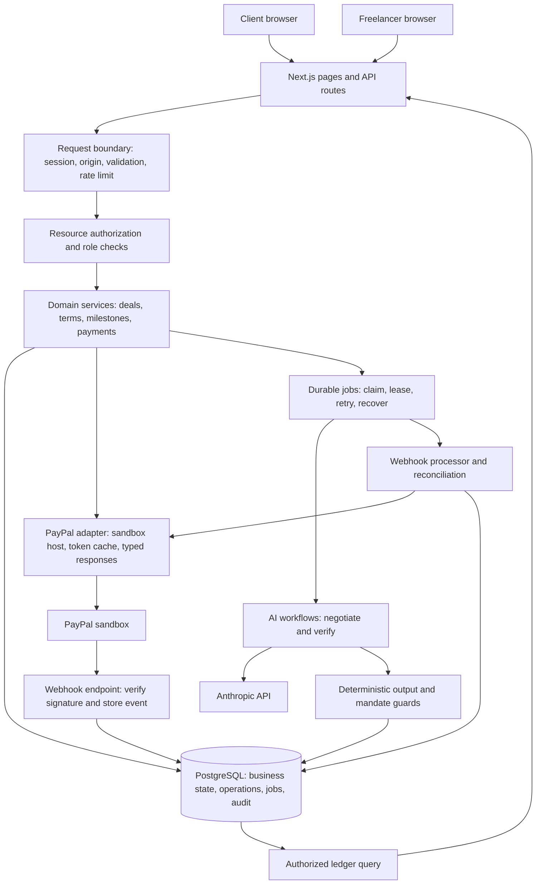

# HoldFast — Review and Feedback

Prepared: 10 November 2026  
Reviewed material: PAYPAL_HACKATHON_MASTER_PLAN.md and the current local source code  
Review type: Product and technical design review; not a production certification

## Overall assessment

HoldFast has a coherent core: agents negotiate measurable acceptance criteria, both people approve the terms, PayPal authorizes a milestone, AI reviews the submitted evidence, and a person decides whether to release payment.

Recommendation: proceed with a narrower prototype after correcting the payment recovery and concurrency issues below. The current repository is a foundation, not yet a working end-to-end payment application.

## What is working well in the plan

- PayPal authorization is central to the experience.
- Acceptance criteria connect negotiation, delivery, and verification.
- AI recommends; deterministic code and human decisions control payments.
- Separate model inputs reduce direct exposure of opposing mandates.
- Integer cents, versioned terms, explicit signatures, and audit events are appropriate choices.
- One Next.js service and PostgreSQL keep deployment manageable.
- Deferring a vector database and general-purpose agent framework avoids unnecessary complexity.

## Required corrections before payment implementation

| Priority | Finding | Recommended correction | Acceptance check |
|---|---|---|---|
| Critical | Steps 6.3 and 6.5 prefix a 36-character UUID with auth- or void-, producing 41 characters. PayPal documents a 38-character request-ID limit. | Persist a separate plain UUID for each operation. | Every supported payment mutation has a valid, stable request ID. |
| Critical | Step 6.4 marks every PayPalError as FAILED and permits another capture attempt. A server error may leave the external outcome uncertain. | Preserve REQUESTED/UNKNOWN status; reconcile or retry the same operation ID before permitting replacement. | Simulate capture success with a lost response; retry recovers the same operation. |
| High | An existing capture can be returned by key without an explicit resource/actor/payload binding check. | Bind keys to operation type, milestone, actor, and request fingerprint. | Reusing a key with another resource or amount is rejected. |
| High | Multiple CREATED funding attempts are allowed; the AUTHORIZED uniqueness constraint acts only after an external authorization may occur. | Permit one active funding operation per milestone, including creation and authorization in progress. | Two simultaneous funding requests cannot create two active external holds. |
| High | A REQUESTED capture without a stored PayPal ID does not have a complete resume path. | Resume the existing operation rather than inserting its primary key again. | Restart after operation insertion and recover successfully. |
| High | PENDING capture is represented as RELEASED. | Add a processing state and mark released only after confirmed completion. | Pending capture never triggers a completed-payment claim or payout. |
| High | Stored webhook events are discarded as duplicates even if processing never completed. | Retry unprocessed events and temporarily unmatched events, with backoff and bounded attempts. | Crash after event insertion; redelivery or recovery finishes processing. |
| High | Work and payment state are combined. A lapsed hold can erase the apparent submitted-work state. | Track work, authorization, capture, and payout state separately. | Hold expiry and re-funding preserve submissions and revision history. |

Sources:
- PayPal idempotency: https://developer.paypal.com/api/rest/reference/idempotency/
- Capture statuses: https://developer.paypal.com/api/payments/v2/definitions/capture_status/

## Product positioning and payment promises

Change claims that exceed what the demonstrated integration establishes:

| Existing wording | Suggested wording |
|---|---|
| Proof of funds / certainty of payment | PayPal authorization before work begins |
| Without custody | Sandbox prototype using one merchant account; direct seller settlement is future work |
| Proof of work without argument | Evidence-based review against agreed criteria |
| Nothing connects these capabilities | Describe the demonstrated differentiation without claiming an exhaustive market gap |

PayPal documents a 29-day authorization period and a three-day honor period. Capture remains subject to risk checks and available funds. The two-week example needs a clear authorization recovery policy; a reservation must not be presented as guaranteed payment.

Source: https://developer.paypal.com/v5/checkout/auth-capture

## AI and verification feedback

1. Separate contexts prevent directly including both mandates in one request. They do not guarantee that a model will never disclose private information in its public response.
2. Treat the numeric leak guard as best effort. Test limits expressed in words, indirect disclosures, and private priorities.
3. Accept proposals by immutable proposal ID; preserve the exact terms accepted.
4. Assign immutable criterion IDs and require exactly one verdict for each ID. Count matching alone is insufficient.
5. Preserve evidence source, observation time, submission identity, model, and prompt version.
6. Use unclear when behavior was not observed. A form in page content does not prove successful submission; viewport metadata does not prove a usable mobile layout.
7. Do not present model confidence as a calibrated probability.
8. Provider-side URL fetching removes this application's direct fetch path, but residual prompt-injection and exfiltration risks remain. Restrict domains where appropriate.
9. Keep replay visibly labeled and scoped to the scenario it represents; never present prerecorded output as fresh evaluation of arbitrary work.

Anthropic references:
- Models: https://platform.claude.com/docs/en/models/overview
- Web fetch: https://platform.claude.com/docs/en/agents-and-tools/tool-use/web-fetch-tool

## Background execution and security

- Persist negotiation run identity and ownership. A stale run must not overwrite a newer run's turns or terms.
- Use a lease/heartbeat and recovery after restart; detached promises are not durable jobs.
- Keep administrative access separate from public demo personas.
- Isolate demo sessions/deals to reduce interference between visitors.
- Add a global daily model-spending budget. Per-deal limits alone are bypassable by creating more deals.
- Enforce authorization on the server for every resource and action.
- Write business state and its audit event transactionally where practical.
- Describe audit records as append-only by application convention until database permissions enforce that property.
- Resolve the retention contradiction between webhook payload NOT NULL and a policy of nulling old payloads.
- Define a terminal outcome when all milestones are cancelled.

## Current implementation assessment

The inspected source contains:
- Landing page and setup workspace.
- Database connection and health endpoint.
- Sandbox configuration guard.
- Money helpers, rate limiter, and basic milestone transition checks.
- PayPal OAuth/request and order/payment helpers.
- Eight unit tests that passed during the earlier implementation pass.

Not yet implemented:
- Authentication and resource authorization.
- Database schema migrations and seed data.
- Deal creation/joining, AI negotiation, terms editing, and signatures.
- Payment route handlers, reconciliation, and durable webhook processing.
- Deliverable verification, ledger, payouts, and hosted end-to-end demonstration.

Code-specific improvements:
- Require and validate request IDs for supported payment mutations.
- Classify network/timeout outcomes explicitly.
- Validate external responses at runtime.
- Map illegal state transitions to a conflict response instead of a generic internal error.
- Validate APP_URL as an allowed HTTP origin and DATABASE_URL as a database connection URL.
- Align fallback database configuration with the working local setup.
- Add the security headers described in the plan.
- Distinguish database connectivity from schema/application readiness.

Verification limits: no live PayPal or Anthropic request was verified in this review. Browser visual inspection was unavailable. Previously passing unit tests do not establish end-to-end integration correctness.

## Recommended submission scope

Keep:
- Client and freelancer access.
- One complete deal and funded-milestone flow.
- Negotiation with deterministic mandate guards.
- Human approval of terms.
- Authorization, submission, verification, human release, capture, and void.
- Durable webhook processing and an auditable ledger.
- README, run instructions, and demonstration video.

Defer:
- Mediation, ledger chat, refunds, auto-release, general administration UI, and complex payout management.

If payouts are omitted, explicitly state that capture reaches the sandbox merchant account. Do not claim the freelancer has been paid.

## Delivery gates

| Gate | Evidence required |
|---|---|
| Sandbox access | Real sandbox order approval, authorization, capture, and void recorded |
| Payment recovery | Lost-response retry recovers the original operation; concurrent requests remain safe |
| Agreement | Both signatures refer to the same immutable terms version |
| Verification | Criterion IDs match exactly; missing evidence produces unclear |
| Integration | Browser flow completes without editing SQL or calling payment endpoints manually |
| Submission | Working build, public licensed source, accurate README, and public video under three minutes |

The published deadline is 13 November 2026 at 01:30 IST. The plan's six-hour submission buffer means targeting 12 November at 19:30 IST.

A functional build is required. Clear setup instructions can substitute for hosting, but a static interface does not satisfy the functional-demo requirement.

Render's free PostgreSQL expires after 30 days and free web services sleep after inactivity. Execute an availability plan through the end of judging.

Sources:
- Official rules: https://paypalaihackathon.devpost.com/rules
- Render free-tier limits: https://render.com/docs/free

## Suggested next action

Prove one complete application flow with real sandbox authorization and capture, then demonstrate recovery from a lost response. Correct the payment and webhook issues before expanding features.

The idea is worth pursuing. A smaller, demonstrably correct implementation will be more convincing than a broader plan with unverified payment behavior.


## Architecture review and recommended design

### Assessment

The single Next.js service plus PostgreSQL is appropriate for the hackathon. Keep one deployable application and one relational database. The main architectural correction is to make external operations and background work recoverable, rather than relying on an in-memory process or a successful browser redirect.

This is a recommended design. Most of these components are not implemented in the current repository.

### Recommended component architecture



The job runner can initially run inside the same Node service. Its job records and leases must live in PostgreSQL so work survives a process restart. A separate worker service or Redis is not required for the first prototype.

### Responsibilities and boundaries

| Component | Owns | Must not own |
|---|---|---|
| Browser | Forms, progress, explicit confirmations, rendering allowed actions | Final authorization, authoritative amounts, payment state |
| API boundary | Sessions, origin checks, input validation, request IDs, limits | Business transitions scattered across handlers |
| Domain services | Membership checks, signed terms, allowed transitions, operation creation | Provider-specific HTTP details |
| Payment adapter | OAuth, fixed sandbox base URL, external requests and response validation | Deciding who may release or how much they may release |
| AI workflows | Bounded negotiation and evidence review | Credentials, capture tools, payout execution |
| Output guards | Mandate enforcement, schema and criterion identity checks | Assuming prompts guarantee compliance |
| Job runner | Durable claims, leases, retry schedules, recovery | Treating detached promises as reliable queues |
| Webhook ingress | Signature verification, event validation, durable receipt | Assuming receipt equals completed processing |
| Reconciler | Reading provider state and repairing known operations | Blindly replaying arbitrary money mutations |
| Ledger | Authorized views of recorded business and money events | Becoming a second authoritative payment state |

The AI boundary should be enforced with import restrictions or tests: AI modules must not import payment-execution or secret-bearing modules. The verifier may use provider-side fetching, subject to the restrictions described earlier.

### Payment operation architecture

Keep payment operations distinct from milestone business state. A lightweight payment_operations table can contain:

| Field | Purpose |
|---|---|
| id | Plain UUID used as the stable external request ID where supported |
| milestone_id | Resource binding |
| actor_user_id | Recorded human actor |
| operation_type | Create order, authorize, capture, void, payout |
| request_fingerprint | Canonical hash of immutable operation parameters |
| amount_cents and currency | Snapshotted amount and currency |
| status | REQUESTED, IN_PROGRESS, UNKNOWN, PENDING, SUCCEEDED, FAILED |
| provider_object_id | Known external object ID |
| attempt_count, next_attempt_at | Retry control |
| lease_owner, lease_expires_at | Exclusive processing and crash recovery |
| last_error_code, debug_id | Diagnostic metadata |
| created_at, updated_at | Lifecycle timestamps |

Existing order/capture/payout tables can implement these properties instead of adding a generic table. Choose one approach consistently; avoid two competing sources of operation status.

Store operation parameters before sending the external request. Do not recompute them from later-edited records when resuming.

```mermaid
sequenceDiagram
  actor U as Client
  participant API as API and domain service
  participant DB as PostgreSQL
  participant PP as PayPal sandbox
  U->>API: Confirm release with idempotency key
  API->>DB: Transaction: authorize, lock milestone, create or load bound operation
  DB-->>API: Stable operation ID and immutable parameters
  API->>PP: Capture using stable request ID
  alt Confirmed completed
    PP-->>API: Capture ID and COMPLETED
    API->>DB: Transaction: operation success, payment state, audit event
  else Pending
    PP-->>API: Capture ID and PENDING
    API->>DB: Persist pending state; schedule reconciliation
  else Timeout or uncertain server outcome
    API->>DB: Preserve UNKNOWN; schedule recovery
    Note over API,DB: Do not allow a replacement money operation until resolved
  end
  API-->>U: Completed, processing, or awaiting confirmation
```

A lease coordinates local workers; it does not itself prevent duplicate external actions after a crash. Stable provider idempotency IDs and reconciliation remain essential.

### Durable webhook architecture

1. Verify the signature and validate the event.
2. Insert the event by its provider event ID.
3. Ensure an unprocessed event has a durable processing job.
4. A processor claims the event and applies idempotent domain changes.
5. Commit domain changes, audit events, and processed status together where practical.
6. Retry transient or temporarily unmatched events.
7. Expose exhausted retries for operator attention.

A duplicate received event must not be mistaken for an already processed event. A periodic scan can recover stored events that have no pending job.

Use authoritative provider reads when event ordering or an uncertain operation outcome cannot be resolved safely from local state.

### Separate work and money state

| Record or dimension | Example state |
|---|---|
| Work | Awaiting delivery, submitted, revision requested, accepted |
| Authorization | Requested, authorized, expired, voided |
| Capture | Requested, unknown, pending, completed, failed |
| Payout | Disabled, requested, processing, succeeded, needs attention |

Compute the user-facing summary and allowed actions from these dimensions. Hold expiry must not remove submission history. A pending capture must not appear as completed payment.

### Agreement and AI execution architecture

- Give each negotiation run an immutable run ID, status, lease, and heartbeat.
- Check run ownership before persisting each turn or final terms.
- A superseded or expired run cannot overwrite a newer result.
- Give proposals, terms versions, submissions, and criteria immutable IDs.
- Bind signatures to the same terms version or canonical snapshot.
- Verify the submitted artifact against the signed criteria snapshot.
- Store the model and prompt version used for the report.
- Human acceptance of a report and a payment operation remain separate records.

For a small demo, polling is appropriate. WebSockets add complexity without improving correctness.

### What should change in the master plan

| Keep | Change |
|---|---|
| One Next.js service | Replace detached background promises with durable database-backed jobs |
| PostgreSQL and Drizzle | Add operation recovery fields, job leases, and webhook processing attempts |
| Separate model calls | Qualify privacy claims and add output-disclosure checks |
| Human payment confirmation | Bind confirmation to immutable operation parameters |
| PayPal request IDs | Use separate valid UUIDs and enforce resource/payload binding |
| Webhook de-duplication | Distinguish durable receipt from successful processing |
| Audit ledger | Write audit and business changes transactionally |
| Single-instance deployment | Recover jobs after restart; document the scaling boundary |
| Polling | Preserve it for the hackathon |
| Admin UI as optional | Keep reconciliation and recovery capability mandatory |

### Architecture acceptance criteria

- Restarting the service does not permanently strand negotiation or webhook work.
- Two workers cannot successfully own the same current job lease.
- A stale negotiating run cannot overwrite current terms.
- A retried payment operation uses the same immutable parameters and request ID.
- The same key cannot be reused for another actor, resource, or payload.
- An uncertain external outcome blocks replacement payment operations.
- A duplicate webhook can recover unfinished processing without duplicating side effects.
- Payment and work states remain consistent through hold expiry, pending capture, and delayed events.
- AI workflows have no route to execute a payment.
- Current source, proposed architecture, and verified runtime behavior are described separately.

### Suggested architecture feedback to the author

The overall stack is suitable. The important changes are in reliability and responsibility boundaries: persist background work, model payment operations explicitly, separate work state from payment state, and make webhook processing recoverable. Keep these mechanisms small and database-backed for the hackathon. Avoid adding more services until the single-service design has a verified end-to-end flow.
# HoldFast — Review and Feedback

Prepared: 10 November 2026  
Reviewed material: PAYPAL_HACKATHON_MASTER_PLAN.md and the current local source code  
Review type: Product and technical design review; not a production certification

## Overall assessment

HoldFast has a coherent core: agents negotiate measurable acceptance criteria, both people approve the terms, PayPal authorizes a milestone, AI reviews the submitted evidence, and a person decides whether to release payment.

Recommendation: proceed with a narrower prototype after correcting the payment recovery and concurrency issues below. The current repository is a foundation, not yet a working end-to-end payment application.

## What is working well in the plan

- PayPal authorization is central to the experience.
- Acceptance criteria connect negotiation, delivery, and verification.
- AI recommends; deterministic code and human decisions control payments.
- Separate model inputs reduce direct exposure of opposing mandates.
- Integer cents, versioned terms, explicit signatures, and audit events are appropriate choices.
- One Next.js service and PostgreSQL keep deployment manageable.
- Deferring a vector database and general-purpose agent framework avoids unnecessary complexity.

## Required corrections before payment implementation

| Priority | Finding | Recommended correction | Acceptance check |
|---|---|---|---|
| Critical | Steps 6.3 and 6.5 prefix a 36-character UUID with auth- or void-, producing 41 characters. PayPal documents a 38-character request-ID limit. | Persist a separate plain UUID for each operation. | Every supported payment mutation has a valid, stable request ID. |
| Critical | Step 6.4 marks every PayPalError as FAILED and permits another capture attempt. A server error may leave the external outcome uncertain. | Preserve REQUESTED/UNKNOWN status; reconcile or retry the same operation ID before permitting replacement. | Simulate capture success with a lost response; retry recovers the same operation. |
| High | An existing capture can be returned by key without an explicit resource/actor/payload binding check. | Bind keys to operation type, milestone, actor, and request fingerprint. | Reusing a key with another resource or amount is rejected. |
| High | Multiple CREATED funding attempts are allowed; the AUTHORIZED uniqueness constraint acts only after an external authorization may occur. | Permit one active funding operation per milestone, including creation and authorization in progress. | Two simultaneous funding requests cannot create two active external holds. |
| High | A REQUESTED capture without a stored PayPal ID does not have a complete resume path. | Resume the existing operation rather than inserting its primary key again. | Restart after operation insertion and recover successfully. |
| High | PENDING capture is represented as RELEASED. | Add a processing state and mark released only after confirmed completion. | Pending capture never triggers a completed-payment claim or payout. |
| High | Stored webhook events are discarded as duplicates even if processing never completed. | Retry unprocessed events and temporarily unmatched events, with backoff and bounded attempts. | Crash after event insertion; redelivery or recovery finishes processing. |
| High | Work and payment state are combined. A lapsed hold can erase the apparent submitted-work state. | Track work, authorization, capture, and payout state separately. | Hold expiry and re-funding preserve submissions and revision history. |

Sources:
- PayPal idempotency: https://developer.paypal.com/api/rest/reference/idempotency/
- Capture statuses: https://developer.paypal.com/api/payments/v2/definitions/capture_status/

## Product positioning and payment promises

Change claims that exceed what the demonstrated integration establishes:

| Existing wording | Suggested wording |
|---|---|
| Proof of funds / certainty of payment | PayPal authorization before work begins |
| Without custody | Sandbox prototype using one merchant account; direct seller settlement is future work |
| Proof of work without argument | Evidence-based review against agreed criteria |
| Nothing connects these capabilities | Describe the demonstrated differentiation without claiming an exhaustive market gap |

PayPal documents a 29-day authorization period and a three-day honor period. Capture remains subject to risk checks and available funds. The two-week example needs a clear authorization recovery policy; a reservation must not be presented as guaranteed payment.

Source: https://developer.paypal.com/v5/checkout/auth-capture

## AI and verification feedback

1. Separate contexts prevent directly including both mandates in one request. They do not guarantee that a model will never disclose private information in its public response.
2. Treat the numeric leak guard as best effort. Test limits expressed in words, indirect disclosures, and private priorities.
3. Accept proposals by immutable proposal ID; preserve the exact terms accepted.
4. Assign immutable criterion IDs and require exactly one verdict for each ID. Count matching alone is insufficient.
5. Preserve evidence source, observation time, submission identity, model, and prompt version.
6. Use unclear when behavior was not observed. A form in page content does not prove successful submission; viewport metadata does not prove a usable mobile layout.
7. Do not present model confidence as a calibrated probability.
8. Provider-side URL fetching removes this application's direct fetch path, but residual prompt-injection and exfiltration risks remain. Restrict domains where appropriate.
9. Keep replay visibly labeled and scoped to the scenario it represents; never present prerecorded output as fresh evaluation of arbitrary work.

Anthropic references:
- Models: https://platform.claude.com/docs/en/models/overview
- Web fetch: https://platform.claude.com/docs/en/agents-and-tools/tool-use/web-fetch-tool

## Background execution and security

- Persist negotiation run identity and ownership. A stale run must not overwrite a newer run's turns or terms.
- Use a lease/heartbeat and recovery after restart; detached promises are not durable jobs.
- Keep administrative access separate from public demo personas.
- Isolate demo sessions/deals to reduce interference between visitors.
- Add a global daily model-spending budget. Per-deal limits alone are bypassable by creating more deals.
- Enforce authorization on the server for every resource and action.
- Write business state and its audit event transactionally where practical.
- Describe audit records as append-only by application convention until database permissions enforce that property.
- Resolve the retention contradiction between webhook payload NOT NULL and a policy of nulling old payloads.
- Define a terminal outcome when all milestones are cancelled.

## Current implementation assessment

The inspected source contains:
- Landing page and setup workspace.
- Database connection and health endpoint.
- Sandbox configuration guard.
- Money helpers, rate limiter, and basic milestone transition checks.
- PayPal OAuth/request and order/payment helpers.
- Eight unit tests that passed during the earlier implementation pass.

Not yet implemented:
- Authentication and resource authorization.
- Database schema migrations and seed data.
- Deal creation/joining, AI negotiation, terms editing, and signatures.
- Payment route handlers, reconciliation, and durable webhook processing.
- Deliverable verification, ledger, payouts, and hosted end-to-end demonstration.

Code-specific improvements:
- Require and validate request IDs for supported payment mutations.
- Classify network/timeout outcomes explicitly.
- Validate external responses at runtime.
- Map illegal state transitions to a conflict response instead of a generic internal error.
- Validate APP_URL as an allowed HTTP origin and DATABASE_URL as a database connection URL.
- Align fallback database configuration with the working local setup.
- Add the security headers described in the plan.
- Distinguish database connectivity from schema/application readiness.

Verification limits: no live PayPal or Anthropic request was verified in this review. Browser visual inspection was unavailable. Previously passing unit tests do not establish end-to-end integration correctness.

## Recommended submission scope

Keep:
- Client and freelancer access.
- One complete deal and funded-milestone flow.
- Negotiation with deterministic mandate guards.
- Human approval of terms.
- Authorization, submission, verification, human release, capture, and void.
- Durable webhook processing and an auditable ledger.
- README, run instructions, and demonstration video.

Defer:
- Mediation, ledger chat, refunds, auto-release, general administration UI, and complex payout management.

If payouts are omitted, explicitly state that capture reaches the sandbox merchant account. Do not claim the freelancer has been paid.

## Delivery gates

| Gate | Evidence required |
|---|---|
| Sandbox access | Real sandbox order approval, authorization, capture, and void recorded |
| Payment recovery | Lost-response retry recovers the original operation; concurrent requests remain safe |
| Agreement | Both signatures refer to the same immutable terms version |
| Verification | Criterion IDs match exactly; missing evidence produces unclear |
| Integration | Browser flow completes without editing SQL or calling payment endpoints manually |
| Submission | Working build, public licensed source, accurate README, and public video under three minutes |

The published deadline is 13 November 2026 at 01:30 IST. The plan's six-hour submission buffer means targeting 12 November at 19:30 IST.

A functional build is required. Clear setup instructions can substitute for hosting, but a static interface does not satisfy the functional-demo requirement.

Render's free PostgreSQL expires after 30 days and free web services sleep after inactivity. Execute an availability plan through the end of judging.

Sources:
- Official rules: https://paypalaihackathon.devpost.com/rules
- Render free-tier limits: https://render.com/docs/free

## Suggested next action

Prove one complete application flow with real sandbox authorization and capture, then demonstrate recovery from a lost response. Correct the payment and webhook issues before expanding features.

The idea is worth pursuing. A smaller, demonstrably correct implementation will be more convincing than a broader plan with unverified payment behavior.


## Architecture review and recommended design

### Assessment

The single Next.js service plus PostgreSQL is appropriate for the hackathon. Keep one deployable application and one relational database. The main architectural correction is to make external operations and background work recoverable, rather than relying on an in-memory process or a successful browser redirect.

This is a recommended design. Most of these components are not implemented in the current repository.

### Recommended component architecture


The job runner can initially run inside the same Node service. Its job records and leases must live in PostgreSQL so work survives a process restart. A separate worker service or Redis is not required for the first prototype.

### Responsibilities and boundaries

| Component | Owns | Must not own |
|---|---|---|
| Browser | Forms, progress, explicit confirmations, rendering allowed actions | Final authorization, authoritative amounts, payment state |
| API boundary | Sessions, origin checks, input validation, request IDs, limits | Business transitions scattered across handlers |
| Domain services | Membership checks, signed terms, allowed transitions, operation creation | Provider-specific HTTP details |
| Payment adapter | OAuth, fixed sandbox base URL, external requests and response validation | Deciding who may release or how much they may release |
| AI workflows | Bounded negotiation and evidence review | Credentials, capture tools, payout execution |
| Output guards | Mandate enforcement, schema and criterion identity checks | Assuming prompts guarantee compliance |
| Job runner | Durable claims, leases, retry schedules, recovery | Treating detached promises as reliable queues |
| Webhook ingress | Signature verification, event validation, durable receipt | Assuming receipt equals completed processing |
| Reconciler | Reading provider state and repairing known operations | Blindly replaying arbitrary money mutations |
| Ledger | Authorized views of recorded business and money events | Becoming a second authoritative payment state |

The AI boundary should be enforced with import restrictions or tests: AI modules must not import payment-execution or secret-bearing modules. The verifier may use provider-side fetching, subject to the restrictions described earlier.

### Payment operation architecture

Keep payment operations distinct from milestone business state. A lightweight payment_operations table can contain:

| Field | Purpose |
|---|---|
| id | Plain UUID used as the stable external request ID where supported |
| milestone_id | Resource binding |
| actor_user_id | Recorded human actor |
| operation_type | Create order, authorize, capture, void, payout |
| request_fingerprint | Canonical hash of immutable operation parameters |
| amount_cents and currency | Snapshotted amount and currency |
| status | REQUESTED, IN_PROGRESS, UNKNOWN, PENDING, SUCCEEDED, FAILED |
| provider_object_id | Known external object ID |
| attempt_count, next_attempt_at | Retry control |
| lease_owner, lease_expires_at | Exclusive processing and crash recovery |
| last_error_code, debug_id | Diagnostic metadata |
| created_at, updated_at | Lifecycle timestamps |

Existing order/capture/payout tables can implement these properties instead of adding a generic table. Choose one approach consistently; avoid two competing sources of operation status.

Store operation parameters before sending the external request. Do not recompute them from later-edited records when resuming.

```mermaid
sequenceDiagram
  actor U as Client
  participant API as API and domain service
  participant DB as PostgreSQL
  participant PP as PayPal sandbox
  U->>API: Confirm release with idempotency key
  API->>DB: Transaction: authorize, lock milestone, create or load bound operation
  DB-->>API: Stable operation ID and immutable parameters
  API->>PP: Capture using stable request ID
  alt Confirmed completed
    PP-->>API: Capture ID and COMPLETED
    API->>DB: Transaction: operation success, payment state, audit event
  else Pending
    PP-->>API: Capture ID and PENDING
    API->>DB: Persist pending state; schedule reconciliation
  else Timeout or uncertain server outcome
    API->>DB: Preserve UNKNOWN; schedule recovery
    Note over API,DB: Do not allow a replacement money operation until resolved
  end
  API-->>U: Completed, processing, or awaiting confirmation
```

A lease coordinates local workers; it does not itself prevent duplicate external actions after a crash. Stable provider idempotency IDs and reconciliation remain essential.

### Durable webhook architecture

1. Verify the signature and validate the event.
2. Insert the event by its provider event ID.
3. Ensure an unprocessed event has a durable processing job.
4. A processor claims the event and applies idempotent domain changes.
5. Commit domain changes, audit events, and processed status together where practical.
6. Retry transient or temporarily unmatched events.
7. Expose exhausted retries for operator attention.

A duplicate received event must not be mistaken for an already processed event. A periodic scan can recover stored events that have no pending job.

Use authoritative provider reads when event ordering or an uncertain operation outcome cannot be resolved safely from local state.

### Separate work and money state

| Record or dimension | Example state |
|---|---|
| Work | Awaiting delivery, submitted, revision requested, accepted |
| Authorization | Requested, authorized, expired, voided |
| Capture | Requested, unknown, pending, completed, failed |
| Payout | Disabled, requested, processing, succeeded, needs attention |

Compute the user-facing summary and allowed actions from these dimensions. Hold expiry must not remove submission history. A pending capture must not appear as completed payment.

### Agreement and AI execution architecture

- Give each negotiation run an immutable run ID, status, lease, and heartbeat.
- Check run ownership before persisting each turn or final terms.
- A superseded or expired run cannot overwrite a newer result.
- Give proposals, terms versions, submissions, and criteria immutable IDs.
- Bind signatures to the same terms version or canonical snapshot.
- Verify the submitted artifact against the signed criteria snapshot.
- Store the model and prompt version used for the report.
- Human acceptance of a report and a payment operation remain separate records.

For a small demo, polling is appropriate. WebSockets add complexity without improving correctness.

### What should change in the master plan

| Keep | Change |
|---|---|
| One Next.js service | Replace detached background promises with durable database-backed jobs |
| PostgreSQL and Drizzle | Add operation recovery fields, job leases, and webhook processing attempts |
| Separate model calls | Qualify privacy claims and add output-disclosure checks |
| Human payment confirmation | Bind confirmation to immutable operation parameters |
| PayPal request IDs | Use separate valid UUIDs and enforce resource/payload binding |
| Webhook de-duplication | Distinguish durable receipt from successful processing |
| Audit ledger | Write audit and business changes transactionally |
| Single-instance deployment | Recover jobs after restart; document the scaling boundary |
| Polling | Preserve it for the hackathon |
| Admin UI as optional | Keep reconciliation and recovery capability mandatory |

### Architecture acceptance criteria

- Restarting the service does not permanently strand negotiation or webhook work.
- Two workers cannot successfully own the same current job lease.
- A stale negotiating run cannot overwrite current terms.
- A retried payment operation uses the same immutable parameters and request ID.
- The same key cannot be reused for another actor, resource, or payload.
- An uncertain external outcome blocks replacement payment operations.
- A duplicate webhook can recover unfinished processing without duplicating side effects.
- Payment and work states remain consistent through hold expiry, pending capture, and delayed events.
- AI workflows have no route to execute a payment.
- Current source, proposed architecture, and verified runtime behavior are described separately.

### Suggested architecture feedback to the author

The overall stack is suitable. The important changes are in reliability and responsibility boundaries: persist background work, model payment operations explicitly, separate work state from payment state, and make webhook processing recoverable. Keep these mechanisms small and database-backed for the hackathon. Avoid adding more services until the single-service design has a verified end-to-end flow.
